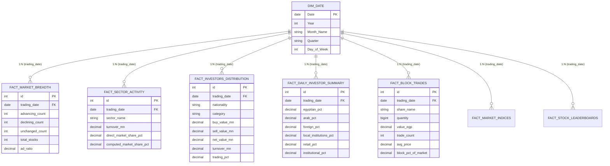

# Project Assignment 2: Sigma Capital Market Overview Analysis
## Comprehensive Data Inventory, Calculation Logic, and Dashboard Specification

**Project Name:** Sigma Capital Market Overview & Trading Reports (Egyptian Market / EGX)  
**Author:** Ahmed Hassan  
**Date:** October 2026  
**Target Portal:**
- **Sigma Capital Market Overview:** `https://www.sigma-cap.com/main/fl_market_page.overview?u_sess=`

---

## Executive Summary
This document provides the formal data architecture and business intelligence specification required for **Project Assignment 2**. It establishes a complete inventory of market data points, defines their exact web sources, distinguishes directly extractable elements from derived analytical metrics, and details the dashboard layout and KPI strategy for an executive Power BI reporting system.

---

## 1. Complete Field Inventory & Source Mapping (Deliverables 1 & 2)

The tables below map every data point available across the Market Overview portal, categorized by analytical domain.

### 1.1 Investor Participation & Trading Activity
- **Source Section:** Investors Distribution & Activity Table (`div#investors_pie_body` and associated data tables)
- **Granularity:** Daily closing snapshot by Nationality and Category

| Business Field Name | Physical Column / Label | Data Type | Unit / Format | Web Source Location | Description |
| :--- | :--- | :--- | :--- | :--- | :--- |
| **Trading Date** | Implicit / Header Date | Date | `YYYY-MM-DD` | Top banner / System timestamp | The calendar date of the trading session. |
| **Investor Nationality** | Column headers | String | Categorical | Investors Table Columns | Categorized into `Egyptian`, `Arab`, and `Foreign`. |
| **Investor Category** | Column sub-headers | String | Categorical | Investors Table Columns | Categorized into `Retail` (Individuals) and `Institutional`. |
| **Buy Value** | `Buy (M)` | Decimal(18,2)| EGP Millions | Table row `Buy (M)` | Total gross purchase volume executed by segment. |
| **Sell Value** | `Sell (M)` | Decimal(18,2)| EGP Millions | Table row `Sell (M)` | Total gross sales volume executed by segment. |
| **Net Buy / Sell** | `Net (M)` | Decimal(18,2)| EGP Millions | Table row `Net (M)` | Net capital inflow (+) or outflow (-) per segment. |
| **Segment Turnover** | `Turnover (M)` | Decimal(18,2)| EGP Millions | Table row `Turnover (M)` | Total traded value (`Buy + Sell`) for the segment. |
| **Trading Percentage** | `Trading %` | Decimal(5,2) | Percentage (`%`) | Table row `Trading %` | Segment turnover as a percentage of total market turnover. |

---

### 1.2 Market Breadth Metrics
- **Source Section:** Advance / Decline Body (`div#adv_dec_body`)
- **Granularity:** Daily closing market sentiment summary

| Business Field Name | Physical Column / Label | Data Type | Unit / Format | Web Source Location | Description |
| :--- | :--- | :--- | :--- | :--- | :--- |
| **Advancing Stocks** | Advancing | Integer | Count | `span.num` (Green segment) | Count of listed companies whose closing price increased. |
| **Declining Stocks** | Declining | Integer | Count | `span.num` (Red segment) | Count of listed companies whose closing price decreased. |
| **Unchanged Stocks** | Unchanged | Integer | Count | `span.num` (Gray segment) | Count of listed companies whose closing price remained flat. |
| **Total Active Stocks** | Total | Integer | Count | Derived / Sum of counts | Total number of traded issues during the session. |
| **Advance/Decline Ratio**| A/D Ratio | Decimal(10,4)| Ratio | Calculated | Market sentiment indicator measuring advancing vs declining issues. |

---

### 1.3 Sector Activity
- **Source Section:** Sector Activity Overview (`table.tblS2` under Sector Performance)
- **Granularity:** Daily breakdown across all active economic sectors

| Business Field Name | Physical Column / Label | Data Type | Unit / Format | Web Source Location | Description |
| :--- | :--- | :--- | :--- | :--- | :--- |
| **Sector Name** | Sector Name | String | Categorical | Sector Table Column 1 | Official EGX / exchange economic industry classification. |
| **Sector Turnover** | `T/O (EGP Mn)` | Decimal(18,2)| EGP Millions | Sector Table Column 2 | Total traded value within the sector. |
| **Direct Market Share %**| `Mkt %` | Decimal(5,2) | Percentage (`%`) | Sector Table Column 3 | Published percentage contribution to total market turnover. |

---

### 1.4 Block Trades (Special Transactions)
- **Source Section:** Block Trades Table (`table.tblS2` under Block Trading)
- **Granularity:** Individual executed large-lot block orders per security

| Business Field Name | Physical Column / Label | Data Type | Unit / Format | Web Source Location | Description |
| :--- | :--- | :--- | :--- | :--- | :--- |
| **Company / Ticker** | `Share Name` | String | Categorical | Block Table Column 1 | Listed company name or stock ticker. |
| **Trade Quantity** | `Qty.` | BigInt | Number of Shares | Block Table Column 2 | Number of shares transferred in the block execution. |
| **Trade Value** | `Value EGP` | Decimal(18,2)| EGP Currency | Block Table Column 3 | Total monetary value of the block transaction. |
| **Number of Trades** | `Count` | Integer | Count | Block Table Column 4 | Number of deals/executions comprising the transaction. |
| **Avg Block Deal Price** | Derived | Decimal(18,4)| EGP / Share | Calculated | Implied execution price per share for the block. |
| **Block % of Market** | Derived | Decimal(8,4) | Percentage (`%`) | Calculated | Proportion of total daily market turnover represented by the block. |

---

### 1.5 Market Benchmark Indices & Stock Leaderboards
- **Source Section:** Top Overview Tables (`table.tblS2` for Indices, Turnover, Volume, Gainers, Losers, and Fluctuation)
- **Granularity:** Daily closing values

| Business Field Name | Physical Column / Label | Data Type | Unit / Format | Web Source Location | Description |
| :--- | :--- | :--- | :--- | :--- | :--- |
| **Index Name** | `Name` | String | Categorical | Indices Table Column 1 | Benchmark index identifier (`EGX30`, `EGX70E`, `EGX100`, `EGX30C`). |
| **Index Last Value** | `Last` | Decimal(18,2)| Index Points | Indices Table Column 2 | Closing level of the index. |
| **Index Points Change**| `Ch` | Decimal(18,2)| Index Points | Indices Table Column 3 | Absolute points change compared to prior close. |
| **Index Change %** | `Ch%` | Decimal(5,2) | Percentage (`%`) | Indices Table Column 4 | Relative percentage change. |
| **Leaderboard Board** | Board Type | String | Categorical | Pipeline classification | Identifies leaderboard category (`Turnover`, `Volume`, `Best`, `Worst`, `Fluctuation`). |

---

## 2. Extraction Classification & Calculation Logic (Deliverable 3)

Data points are classified into **Directly Extractable** (ingested directly from the DOM) and **Calculated / Derived** (computed via transformation pipeline or DAX).

```
   Raw HTML / DOM
         │
         ├──► Directly Extractable ──────► Raw Ingestion (Staging)
         │    (Counts, Names, Volumes, Values)
         │
         └──► Transformation Engine ─────► Derived Analytical Metrics
              (Formulas & Mathematical Logic)
```

### 2.1 Detailed Transformation Matrix

| Metric Name | Classification | Formula / Mathematical Definition | Business Purpose & Interpretation |
| :--- | :---: | :--- | :--- |
| **Buy Value** | Direct | Raw monetary value from table | Measures gross buying pressure for a specific investor segment. |
| **Sell Value** | Direct | Raw monetary value from table | Measures gross selling pressure for a specific investor segment. |
| **Net Buy / Sell** | Computed | $\text{Net Value} = \text{Buy Value} - \text{Sell Value}$ | Identifies whether an investor segment is a net accumulator ($> 0$) or net distributor ($< 0$) of equities. |
| **Egyptian Investors %** | Computed | $\text{Egyptian Ret. \%} + \text{Egyptian Inst. \%}$ | Overall liquidity contribution of local Egyptian capital to total trading. |
| **Arab Investors %** | Computed | $\text{Arab Ret. \%} + \text{Arab Inst. \%}$ | Cross-border regional capital participation. |
| **Foreign Investors %** | Computed | $\text{Foreign Ret. \%} + \text{Foreign Inst. \%}$ | International institutional and retail capital participation (indicator of FX flows). |
| **Local Institutions %** | Computed | $\text{Egyptian Inst. \%}$ | Quantifies institutional support from domestic pension funds, banks, and asset managers. |
| **Retail vs Inst. Split** | Computed | $\text{Total Ret. \%} \quad\text{vs}\quad \text{Total Inst. \%}$ | Market maturity indicator; dominant retail indicates speculative momentum, while high institutional indicates long-term fundamental positioning. |
| **Advance / Decline Ratio** | Computed | $\text{A/D Ratio} = \frac{\text{Advancing Stocks}}{\text{Declining Stocks}}$ | Broad market strength: $> 1.0$ indicates bullish market breadth; $< 1.0$ indicates broad-based weakness. |
| **Sector Market Share %** | Computed / Verified | $\text{Share \%} = \frac{\text{Sector Turnover}}{\sum \text{Daily Sector Turnover}} \times 100$ | Relative sector rotation and capital concentration. |
| **Avg Block Deal Price** | Computed | $\text{Avg Price} = \frac{\text{Value (EGP)}}{\text{Quantity (Shares)}}$ | Effective execution price of large-lot institutional transactions. |
| **Block % of Market** | Computed | $\text{Block Share \%} = \frac{\text{Block Value (EGP)}}{\text{Total Market Daily Turnover (EGP)}} \times 100$ | Measures the impact of off-market / block deals relative to overall continuous trading. |

---

## 3. Relational & Star Schema Design

To ensure optimal performance in Power BI and prevent multi-table ambiguity, the raw reporting matrices have been normalized into a Kimball-style Star Schema.



> [!NOTE]
> `Dim_Date` is generated dynamically in Power BI using DAX to allow seamless time-intelligence filtering (e.g., Year-to-Date, Month-over-Month) across all 7 fact tables without rigid database-side constraints.

---

## 4. Dashboard Implementation & Visual Architecture (Deliverable 4)

An executive 3-page interactive Power BI dashboard in dark terminal theme has been implemented to deliver actionable market intelligence for the Egyptian Exchange (EGX).

---

### Page 1: Market Overview (Market Pulse & Breadth)
**Target Audience:** Chief Investment Officers (CIOs), Portfolio Managers, Market Observers  
**Core Objective:** High-level executive pulse of daily liquidity, benchmark index performance, and market breadth sentiment.

```
┌────────────────────────────────────────────────────────────────────────────────────────┐
│ [Logo: Ahmed Hassan]   [Index Selector: EGX100 | EGX30 | EGX30C | EGX70E]  [Month] [Day]│
├───────────────────┬───────────────────┬───────────────────┬────────────────────────────┤
│ Market Turnover   │ Index Close Points│ Index Change %    │ Advance / Decline Ratio    │
│ EGP 7.42 Bn       │ 49,596.14         │ +0.64%            │ 5.22                       │
├───────────────────┴───────────────────┴───────────────────┴────────────────────────────┤
│ Stocks changes per day (Donut)   │ Indices performance per day   │ Market Shares by sector    │
│ • Advancing: 188 (78%) [Green]   │ (Clustered Horizontal Bar)    │ (Treemap Visual)           │
│ • Declining: 36 (15%) [Red]      │ • EGX70E: +2.77% [Green]      │ • Financial Services & EP  │
│ • Unchanged: 18 (7%) [Gray]      │ • EGX100: +2.27% [Green]      │ • Industrial, Construction │
│                                  │ • EGX30C: +0.67% [Green]      │ • Real Estate and Hotels   │
│                                  │ • EGX30:  +0.64% [Green]      │ • Healthcare, Banks, etc.  │
└──────────────────────────────────┴───────────────────────────────┴────────────────────────────┘
```

#### Page 1 Visual Components:
1. **Global Header & Navigation:**
   - **Personalized Branding:** Ahmed Hassan executive logo.
   - **Index Quick-Selector Tiles:** Single-click buttons for `EGX100`, `EGX30`, `EGX30C`, and `EGX70E` with active green accent highlighting.
   - **Date Slicers:** Synchronized `Month` and `Day` dropdowns filtering all 3 report pages.
2. **Top Executive KPI Cards:**
   - **Market Turnover (Bn):** Formatted dynamically in billions (`EGP 7.42 Bn`).
   - **Index Close Points:** Exact benchmark closing points with thousands separator (`49,596.14`).
   - **Index Change %:** Signed percentage return (`+0.64%`) colored dynamically (Green on gains, Red on drops).
   - **Advance / Decline Ratio:** Ratio indicator (`5.22`) reflecting overwhelmingly bullish market breadth.
3. **Core Analytical Visuals:**
   - **Stocks Changes Per Day (Donut Chart):** Clear market breadth breakdown: Green for Advancing (188 / 78%), Red for Declining (36 / 15%), and Gray for Unchanged (18 / 7%).
   - **Indices Performance Per Day (One-Sided Bar Chart):** Compares all 4 benchmark returns side-by-side on an absolute positive axis with dynamic green/red fill and custom data labels showing actual signed change.
   - **Market Shares by Sector (Treemap):** Hierarchical market turnover concentration highlighting leading capital magnets (Financial Services, Construction, Real Estate, Healthcare, and Banks).

---

### Page 2: Investor Dynamics (Capital Flows & Participation)
**Target Audience:** Quantitative Researchers, Asset Allocators, Regulatory Analysts  
**Core Objective:** Detail market participation by category (Retail vs Institutional) and track cross-border net capital flows (Foreign & Arab vs Domestic Egyptian).

```
┌────────────────────────────────────────────────────────────────────────────────────────┐
│ [← Back Button] [Logo: Ahmed Hassan]                                    [Month] [Day]  │
├───────────────────┬───────────────────┬───────────────────┬────────────────────────────┤
│ Retail Trading    │ Institutional     │ Net Arab Flow     │ Net Foreign Flow           │
│ Share             │ Trading Share     │ (Mn)              │ (Mn)                       │
│ 15.80%            │ 84.20%            │ +EGP 2.24K Mn     │ +EGP 29.20K Mn             │
├───────────────────┴───────────────────┴───────────────────┴────────────────────────────┤
│ Net Flow by Nationality (Mn)     │ Retail vs Institutional (Mn)  │ Investor Distribution      │
│ (Waterfall / Column Chart)       │ (Donut Chart)                 │ (Expandable Matrix Visual) │
│ • Foreign: +29K (Green)          │ • Institutional: 84.2% (Pink) │ • Egyptian (Inst / Ret)    │
│ • Arab:    +2K  (Green)          │ • Retail:        15.8% (Cyan) │ • Foreign  (Inst / Ret)    │
│ • Egyptian: -31K (Red)           │                               │ • Arab     (Inst / Ret)    │
│                                  │                               │ Buy | Sell | Net | T/O | % │
└──────────────────────────────────┴───────────────────────────────┴────────────────────────────┘
```

#### Page 2 Visual Components:
1. **Top Executive KPI Cards:**
   - **Retail Trading Share:** Share of retail volume (`15.80%`).
   - **Institutional Trading Share:** Dominance of institutional fund capital (`84.20%`).
   - **Net Arab Flow (Mn):** Total net inflow/outflow from Arab investors (`+EGP 2.24K Mn`).
   - **Net Foreign Flow (Mn):** Total net inflow/outflow from international institutions (`+EGP 29.20K Mn`).
2. **Core Analytical Visuals:**
   - **Net Flow by Nationality (Mn) (Waterfall / Column):** Explicitly isolates foreign capital injection versus domestic absorption with green positive bars and red negative distribution bars.
   - **Retail vs Institutional Participation (Donut Chart):** Highlights the balance between speculative individual volume vs fundamental institutional capital (`15.8% Retail` vs `84.2% Institutional`).
   - **Investor Distribution Matrix (Expandable Hierarchy Table):**
     - **Row Drilldown:** `Nationality` $\rightarrow$ `Category` (e.g., `Egyptian` $\rightarrow$ `Institutional`, `Retail`).
     - **Columns:** `Buy (Mn)`, `Sell (Mn)`, `Net Flow (Mn)`, `Turnover (Mn)`, `Trading %`.
     - Distinct row formatting with custom background highlights for Retail (cyan) and Institutional (pink) sub-segments.

---

### Page 3: Block Trades (Special Transactions & Liquidity Concentration)
**Target Audience:** Corporate Finance Advisors, Execution Traders, Research Analysts  
**Core Objective:** Monitor off-market, high-value negotiated transactions and institutional deal concentration.

```
┌────────────────────────────────────────────────────────────────────────────────────────┐
│ [← Back Button] [Logo: Ahmed Hassan]                                    [Month] [Day]  │
├───────────────────┬───────────────────┬───────────────────┬────────────────────────────┤
│ Total Block Value │ Block Trades % of │ Executed Deals    │ Top Block Traded           │
│ (EGP Mn)          │ Total Market      │ Count             │ Stock                      │
│ 697.76M           │ 10.18%            │ 78 Deals          │ Qalaa Financial Investments│
├───────────────────┴───────────────────┴───────────────────┴────────────────────────────┤
│ Top Securities by Block Value    │ Block Trades Execution Register (Detailed Table Visual)     │
│ (Horizontal Bar Chart)           │ Company Name | Qty (Shares) | Value (EGP) | Deals | Avg Px│
│ • Qalaa For Financial Inv: 100M  │ • Qalaa:  16.49M shrs | 99.92M EGP | 12 deals | 12.13 EGP  │
│ • El-Nile Co. For Pharma:   79M  │ • El-Nile: 306K shrs  | 79.08M EGP |  5 deals | 534.27 EGP │
│ • Memphis Pharma:           78M  │ • Memphis: 259K shrs  | 77.90M EGP |  6 deals | 602.52 EGP │
│ • CIB:                      73M  │ • CIB:     603K shrs  | 72.64M EGP | 10 deals | 240.72 EGP │
│ • Fawry Banking:            63M  │ • Fawry:   3.67M shrs | 63.10M EGP | 10 deals | 17.16 EGP  │
└──────────────────────────────────┴─────────────────────────────────────────────────────────────┘
```

#### Page 3 Visual Components:
1. **Top Executive KPI Cards:**
   - **Total Block Value (EGP Mn):** Total negotiated block volume (`697.76M`).
   - **Block Trades % of Total Market:** Weight of block orders relative to total market continuous trading (`10.18%`).
   - **Executed Deals Count:** Total number of executed block trades (`78 Deals`).
   - **Top Block Traded Stock:** The single largest transaction target (`Qalaa For Financial Investments`).
2. **Core Analytical Visuals:**
   - **Top Securities by Block Value (Horizontal Gold Bar Chart):** Ranks companies by block transaction value with gold accent fill (`#F1C40F`) and data labels in millions (Qalaa at 100M, El-Nile at 79M, Memphis Pharma at 78M, CIB at 73M, Fawry at 63M).
   - **Block Trades Execution Register (Data Grid Table):** Comprehensive transactional ledger displaying:
     1. `Company Name`
     2. `Quantity (Shares)` (Formatted with thousands comma, e.g., `16,494,357`)
     3. `Value (EGP)` (Exact currency formatting, e.g., `99,928,449.00`)
     4. `Deals Count` (Number of executions)
     5. `Avg Price (EGP)` (Effective deal price per share)
     6. `% of Market` (Contribution to daily total market volume)
     7. Summary footer totals across all active block transactions (`213.48M shares`, `697.75M EGP`, `78 deals`).

---

## 5. Verification & Automated Delivery Checklist

- [x] **Automated Web Scraper:** Daily data harvesting from Sigma Capital with duplicate prevention ([`scraper.py`](file:///c:/Users/DELL/OneDrive%20-%20Alexandria%20University/Desktop/BI%20projects/Project%202/python/scraper.py)).
- [x] **Derived Metric Engine:** Pipeline computing all missing fields and splits ([`transform_data.py`](file:///c:/Users/DELL/OneDrive%20-%20Alexandria%20University/Desktop/BI%20projects/Project%202/python/transform_data.py)).
- [x] **Database Warehouse:** Live relational star schema populated on SQL Server `LEGACY\LEGACY` (`Sigma_Cap`).
- [x] **One-Click Orchestration:** [`run_scraper.bat`](file:///c:/Users/DELL/OneDrive%20-%20Alexandria%20University/Desktop/BI%20projects/Project%202/python/run_scraper.bat) running Scraping $\rightarrow$ Transforming $\rightarrow$ SQL Loading seamlessly.
- [x] **Formal Deliverables 1–4 Document:** Fully detailed in this document in compliance with `requirements.txt`.
