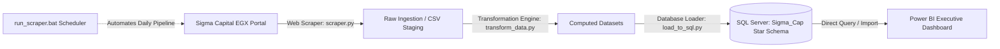

# 📈 Sigma Capital EGX Market Overview & Capital Flows

A full end-to-end Financial Business Intelligence system that extracts daily trading data from the **Egyptian Exchange (EGX)** via Sigma Capital, cleans and transforms market metrics, populates a SQL Server Star Schema, and provides interactive executive dashboards in **Power BI**.

**Author:** Ahmed Hassan  
**Project:** Sigma Capital Market Overview Analysis (Project 2)  
**Live Data Portal:** [Sigma Capital Market Overview](https://www.sigma-cap.com/main/fl_market_page.overview?u_sess=)

---

## 🏛️ System Architecture



---

## 🎯 Key Features & Analytical Scopes

1. **Market Breadth & Index Benchmarks:**
   - Real-time sentiment metrics: Advancing, Declining, and Unchanged issues.
   - Advance/Decline Ratio (Bullish vs. Bearish sentiment threshold).
   - Closing performance across all 4 key EGX benchmark indices: **EGX30**, **EGX70E**, **EGX100**, and **EGX30C**.
2. **Investor Participation & Capital Flow Dynamics:**
   - Granular breakdown across **Retail** (Individuals) vs. **Institutional** capital.
   - Cross-border net capital flows: **Egyptian Domestic**, **Arab Regional**, and **Foreign International**.
   - Net accumulation vs. distribution tracking (`Buy Value - Sell Value`).
3. **Sector Rotation & Liquidity Distribution:**
   - Analysis across all 13 official EGX economic sectors.
   - Turnover concentration and percentage market share calculations.
4. **Block Trades & Large Transactions:**
   - Tracking off-market negotiated institutional transactions.
   - Implied execution price (`Value EGP / Quantity`) vs. market prices.
   - Block trade weight relative to total continuous market turnover.

---

## 📊 Dashboard Visual Tour (Power BI)

The dashboard consists of **3 dark-mode executive pages** featuring personalized branding, synchronized multi-page date filtering, and interactive index selector buttons:

### 1. Market Overview (Market Pulse & Breadth)
- **Top KPIs:** Market Turnover (EGP Bn), Index Close Points, Signed Index Return %, Advance / Decline Ratio.
- **Visuals:** Stocks Changes per day (Donut chart), Benchmark performance per day (Signed one-sided horizontal bars), and Sector Turnover Concentration (Treemap).

### 2. Investor Dynamics (Capital Flows & Participation)
- **Top KPIs:** Retail vs. Institutional trading share %, Net Arab Capital Flow (EGP Mn), Net Foreign Capital Flow (EGP Mn).
- **Visuals:** Net Capital Flow by Nationality (Waterfall / Column chart), Retail vs. Institutional Share (Donut chart), and Granular Investor Matrix with hierarchical drilldown.

### 3. Block Trades (Special Transactions & Liquidity Concentration)
- **Top KPIs:** Total Block Trades Value (EGP Mn), Block % of Total Market, Total Executed Deals, Top Traded Stock.
- **Visuals:** Top Securities by Block Value (Horizontal gold ranking chart) and Comprehensive Block Trades Execution Register (Data grid with quantity, total value, deals count, average price, and market share).

---

## 🗄️ Database Warehouse Design (`Sigma_Cap`)

The relational star schema is hosted on **Microsoft SQL Server** (`Sigma_Cap`), featuring Kimball-style fact tables with duplicate prevention (`MERGE` upsert logic):

| Fact Table Name | Description | Key Computed Metrics |
| :--- | :--- | :--- |
| `fact_market_breadth` | Daily market issues count | Advancing, Declining, Unchanged, `ad_ratio` |
| `fact_sector_activity` | Sector turnover breakdown | Turnover (Mn), Direct %, `computed_market_share_pct` |
| `fact_investors_distribution` | Normalized investor flows | Buy, Sell, `net_value_mn`, Turnover, `trading_pct` |
| `fact_daily_investor_summary`| Macro participant splits | Egyptian %, Arab %, Foreign %, Retail %, Institutional % |
| `fact_block_trades` | Large special transactions | Quantity, Value EGP, `avg_price`, `block_pct_of_market` |
| `fact_market_indices` | Benchmark index tracking | Points Close, Points Change, Return Change % |
| `fact_stock_leaderboards` | Top gainers, losers, volume | Turnover, Volume, High, Low, Price Change |

> **Note:** A dynamic `Dim_Date` calendar table is generated directly inside Power BI using DAX to allow seamless time-intelligence filtering.

---

## 📂 Repository Structure

```
├── python/
│   ├── scraper.py                 # Automated BeautifulSoup & Requests scraper
│   ├── transform_data.py          # Data cleansing and mathematical calculation engine
│   ├── load_to_sql.py             # SQL Server database loader using pyodbc
│   ├── run_scraper.bat            # One-click daily automated pipeline batch runner
│   ├── data/                      # Raw scraped daily CSV files
│   └── computed_data/             # Fully cleaned & calculated analytical datasets
├── SQL/
│   ├── 01_create_sigma_cap_schema.sql         # Original database creation script
│   ├── 02_insert_cleaned_investors.sql        # Investor merge/upsert script
│   ├── 03_create_computed_database_schema.sql # Production star schema DDL
│   └── 04_cleanup_old_tables.sql              # Legacy object cleanup script
├── Project_2_Data_Specification_and_Deliverables.md  # Formal assignment submission document
├── Project 2 requirements.txt                         # Original project requirements specification
├── STAR_SCHEMA_DESIGN.md                              # Detailed dimensional modeling architecture
└── README.md                                          # Project overview and documentation
```

---

## 🚀 Setup & Execution Guide

### Prerequisites
- Python 3.10+
- Microsoft SQL Server & SQL Server Management Studio (SSMS)
- Microsoft Power BI Desktop
- Required Python packages:
  ```bash
  pip install requests beautifulsoup4 pandas numpy pyodbc
  ```

### 1. Database Setup
Execute the DDL script in SQL Server Management Studio (SSMS) to create the schema:
```sql
-- Run SQL/03_create_computed_database_schema.sql
```

### 2. Run the Automated ETL Pipeline
Double-click `python/run_scraper.bat` or run:
```cmd
cd python
run_scraper.bat
```
This executes the 3-stage pipeline:
1. `scraper.py`: Fetches today's live closing data from Sigma Capital (skips weekends/holidays).
2. `transform_data.py`: Calculates net flows, percentage splits, A/D ratios, and block metrics.
3. `load_to_sql.py`: Merges clean records directly into SQL Server `Sigma_Cap`.

### 3. Open Power BI Dashboard
1. Open Power BI Desktop.
2. Connect to SQL Server instance with database `Sigma_Cap`.
3. Open or refresh the `.pbix` report to see live market updates!
